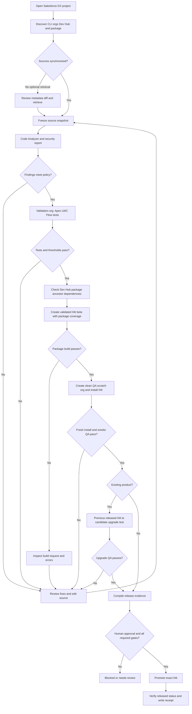
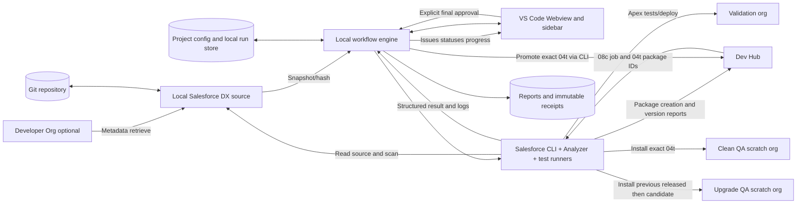

# TwinStack Salesforce Release Assistant
## Product Requirements & Software Requirements Specification (PRD + SRS)

**Version:** 1.0 — architecture baseline  
**Date:** 15 October 2026  
**Platform:** VS Code desktop extension (TypeScript) with a reusable local Salesforce CLI orchestration engine  
**Initial packaging target:** Salesforce managed second-generation packages (2GP)  
**Delivery scope:** From development/source validation to promotion; not AppExchange publication or customer push upgrades.

---

## 1. Executive decision

Build a **native VS Code release-workflow extension** with a visual, step-based pipeline and reusable non-UI orchestration engine. Each stage can run alone, as part of a group, or as part of a pre-approved pipeline. The UI reports state based on verified evidence (CLI results, artifact IDs, source snapshots, and manually signed QA results), not clicks.

**Product promise:** Prepare a reproducible, tested, promotion-ready managed 2GP artifact from a Salesforce DX repository with minimum manual command usage; request explicit human approval before irreversible promotion.

**Critical correction:** Packaging uses project source and the Dev Hub; no deployment of source into the Dev Hub is required. An optional Developer Org-to-local **metadata retrieval** stage is supported, with conflict review. Git/local source remains authoritative for package creation.

**Out of scope for v1:** automatic AppExchange approval, listing publishing, subscriber push upgrades, 1GP, unmanaged/unlocked packages, universally automatic security remediation, comprehensive UI automation without separately authored test scripts, and cloud CI/CD service.

## 2. Intended users and scenarios

- **Salesforce developer:** scans and remediates source, runs tests, builds beta packages, opens clean QA orgs.
- **Tech lead/release engineer:** reviews evidence, performs upgrade QA, authorizes promotion, exports report.
- **ISV/AppExchange team:** uses retained evidence to prepare later security-review and listing steps (not performed by v1).

Primary scenarios:
1. Existing product, new version: modify source -> scan/fix -> tests -> package candidate -> fresh-install QA -> released-version-to-candidate upgrade QA -> approval -> promote.
2. New product: repository/namespace/Dev Hub/package prerequisites -> scan/fix -> tests -> beta -> fresh-install QA -> approval -> promote. Listing/security review are subsequent, separate work.
3. Developer Org sourced project: safely review and retrieve metadata -> Git working tree -> normal package pipeline.
4. Recovery: run fails, display precise error, preserve completed evidence, remedy and resume only valid downstream work.

## 3. Experience / interface

**Activity Bar:** TwinStack Release Assistant icon.  
**Sidebar:** Projects, Pipelines, Org Connections, Runs, Settings.  
**Main Webview:** horizontal stage tracker + selected stage details + actionable checks and logs + right-hand run summary.  
**Native integration:** Problems/Diagnostics, Output Channel, VS Code Notifications, Quick Picks, progress UI, Git diff, open file/line.

Main actions:
- **Inspect Project** (safe, read-only)
- **Sync from Dev Org** (diff review required)
- **Analyze & Fix** (manual acceptance of code changes)
- **Validate Source** (scan + pre-package tests)
- **Prepare QA Package** (validated beta, clean org installation, basic automated QA)
- **Run Upgrade QA** (existing product only)
- **Review Release** (evidence and manual checks)
- **Approve & Promote** (irreversible; explicit confirmation)
- **Retry Step / Resume / Export Report / Open QA Org**

Statuses: `NOT_STARTED`, `RUNNING`, `PASSED`, `FAILED`, `NEEDS_REVIEW`, `BLOCKED`, `STALE`, `SKIPPED`, `CANCELLED`. A skipped required gate is not a pass. Manual checks must be explicitly marked and signed; they cannot pass by inference.

## 4. End-to-end workflow

### Stage 0: Discover & preflight (read-only)
- Verify VS Code workspace is a Salesforce DX project and parse `sfdx-project.json`.
- Discover available `sf` CLI and Code Analyzer v5 plugin, Node, JDK, Python (when needed), Git, test runners.
- Discover authenticated org aliases, Dev Hub, packages, existing released versions; **verify org ID, package ownership and namespace** rather than trusting alias names.
- Validate scratch-org definition, dependencies, package directory, release version, ancestor, installed CLI commands, available features.
- Ask only for unresolved required information; save project-safe choices to project config and secure secrets in protected local storage.
- Check Workspace Trust; in untrusted workspaces limit to read-only operation.

### Stage 1: Source ready
- Default: use the current local Git working tree.
- Optional `Sync from Developer Org`: preview source tracking or manifest retrieval; compute diff, detect local edits, ask before conflicts/overwrites; update working tree only on approval.
- Snapshot source hash / commit, Git dirty state, sfdx project config, org IDs and tool versions. Prefer clean committed source for a release candidate. Never auto-commit or push without user approval.

### Stage 2: Static analysis
- Run Salesforce Code Analyzer v5 with configured recommended and AppExchange/security selectors; capture JSON/SARIF/HTML reports and tool exit status.
- Parse findings by severity, rule, file and line; show counts, filters and clickable navigation.
- Record scan scope, suppressions/config and tool versions. Do not claim security clearance from scanner alone.

### Stage 3: Remediation
- Apply only trusted deterministic fixes supplied by supported analyzers, and only after showing the code diff.
- Optionally ask an AI provider to propose Apex/PMD security or quality remediations; human reviews proposed changes. AI integration opt-in, never sends code externally without explicit consent.
- Re-run relevant scan/test gates after accepted changes. Source changes make affected prior green steps `STALE`.
- Justified false positives: require reason, owner, timestamp and supporting evidence; do not quietly suppress findings.

### Stage 4: Pre-package tests
- Select/create isolated validation org with appropriate features; optionally deploy local source there.
- Run configured Apex tests (e.g. `RunLocalTests`), optional LWC/Jest and Flow tests, and capture test identifiers, failed assertions and **org/test-run coverage**.
- Team-configurable coverage target (proposed 80% internal), but distinguish this from actual **package-version coverage** computed later.
- Gate on failures, not just shell exit code; timeouts become `RUNNING/UNKNOWN` until queried, not automatic failures.

### Stage 5: Package readiness
- Verify package `0Ho`, target Dev Hub org ID, namespace, package directory, dependency graph, version plan and `ancestorVersion/ancestorId` for existing packages.
- Existing releases must use a valid supported descendant path. Explicit opt-in needed to override an ancestor check.
- Release candidate should be built from a clean, tracked snapshot. Installation key handling must be secure; do not default to key bypass.

### Stage 6: Create validated beta package
- Run `sf package version create` with the correct Dev Hub, package reference, **`--code-coverage`** and appropriate package version options; do not use `--skip-validation` for release candidates.
- Record request ID (08c...), poll create report and obtain subscriber version ID (04t...), status, version number and packaged code coverage.
- Package creation is not blindly retried: first check an existing 08c request so restart does not create duplicate artifacts.
- Save fixed association: source snapshot <-> package candidate 04t <-> validation evidence.

### Stage 7: Clean-install QA
- Provision a **new** clean QA scratch org from compatible definition via same Dev Hub (or choose an approved existing clean test org).
- Install the exact candidate `04t`, poll install status, verify installed version, assign configured permission sets, optionally load safe fixture data, run available package smoke tests.
- Open scratch org in browser on user request or using a saved preference.
- Check app opening, user permissions, setup path and feature smoke checks; require manual QA signoff for scenarios not covered by automation.

### Stage 8: Upgrade QA (existing product only)
- MVP: provide a guided checklist and record evidence of a manually executed supported upgrade test; P1 automates its commands.
- In automated mode, create a separate clean org, install the **previous released** 04t, load/seed baseline data, then install the candidate 04t if supported by ancestor/version rules.
- Verify data retention, old-to-new feature behavior, permissions, migration changes, and configured regression tests.
- **Never attempt beta-to-beta upgrade.** Installed beta package versions cannot subsequently be upgraded. On unsupported upgrade paths, explain the reason and block approval.
- New product flow marks this step `NOT_APPLICABLE` instead of green or skipped.

### Stage 9: Release evidence and review
- Re-check exact candidate ID, source fingerprint, valid package code coverage (Salesforce minimum 75%; every package Apex trigger must have coverage), test failures, open critical findings, install result, upgrade result, approvals, dependency and namespace checks.
- Produce human-readable summary (inside extension) and export JSON/Markdown/HTML or archive.
- Manual signoff must record approver and reason. A human can override only explicitly overridable local policy checks, not Salesforce platform constraints.

### Stage 10: Approve & promote
- Show irreversible-action confirmation with product, Dev Hub org ID, package ID, 04t ID, current/released version and evidence hash.
- On approval, execute `sf package version promote` for the exact 04t, then query package version report and verify `Released` status.
- Save promotion receipt. If command outcome is uncertain, **query Salesforce** before retrying.
- End v1 pipeline here; subsequent Partner Console/version association and AppExchange publication are separate workflows.

## 5. Workflow diagram



## 6. Architecture and dataflow

**Architecture:**
1. VS Code UI layer (sidebar Tree View, Webview detail, Problems, Output Channel)
2. Extension Host controller (commands, security checks, event transport, UX)
3. Workflow engine (DAG/states, dependency evaluation, freshness, policy, approval)
4. CLI adapters (Salesforce CLI, Code Analyzer, Git, npm/Jest); spawn with safe argument arrays and predictable cwd; parse JSON where available
5. Report engine (normalized findings, tests, promotion receipt and artifact index)
6. Local project storage (non-secret config, runs, fingerprints, references) and secure secret handling
7. External systems (Dev Org / Dev Hub / scratch org / optional opt-in AI)



**Primary data entities:**
- `ProjectProfile`: workspace URI, package directory/alias/id, Dev Hub org ID/alias, development org, scratch definitions, feature/dependency config, version profile, non-secret policies.
- `Run`: UUID, mode (new/update), started/ended, step graph, snapshot fingerprints, status, actor, outcome.
- `StepExecution`: step ID, attempt, commands/arguments (redacted), timestamps, CLI job/request IDs, checks, error codes, status, evidence IDs.
- `AnalysisFinding`: engine/rule/severity/file/location/recommendation/suppression state.
- `TestResult`: org ID, suite/test names, total/passed/failed, failed diagnostics, org-level test-run coverage.
- `PackageCandidate`: package 0Ho, Dev Hub ID, beta 04t, create request 08c, version, ancestor, package coverage, install key ref (never plaintext stored).
- `QAResult`: target scratch org ID, installed 04t, installation job, smoke-test results, manual checklist/approver.
- `Approval`: user, time, exact 04t, source+evidence fingerprint, decision.
- `PromotionReceipt`: transaction/CLI response, timestamp, verified released status.

**Freshness model:** A successful step is valid only for its fingerprint. Important inputs include selected Git commit + uncommitted diff hash, project and analyzer config hash, CLI/analyzer versions, Salesforce org IDs and org setup where relevant, package ID, candidate 04t and test data set/version. On relevant changes, dependent stages become `STALE`; never show old validations as current successes. Query remote job IDs to reconcile state after VS Code restarts.

## 7. Functional requirements (FR)

| ID | Priority | Requirement and verifiable outcome |
|---|---|---|
| FR-01 | MVP | Recognize a valid Salesforce DX workspace, or explain precisely what is missing. |
| FR-02 | MVP | Discover installed `sf`, Code Analyzer v5, Git and available configured runners; show versions and preflight failures. |
| FR-03 | MVP | Discover authenticated Salesforce orgs, then verify selected Dev Hub and package ownership. |
| FR-04 | MVP | Read `sfdx-project.json` and custom project profile; support multiple workspaces/products without cross-org confusion. |
| FR-05 | MVP | Display pipeline steps with real progress, failure, blocked, needs-review and stale states. |
| FR-06 | MVP | Inspect working-tree changes and display conflicts before metadata retrieval. Never silently overwrite work. |
| FR-07 | MVP | Run Code Analyzer v5 and save parseable plus human-readable output. |
| FR-08 | MVP | Group Code Analyzer findings by rule, severity and location; clicking opens matching source line. |
| FR-09 | MVP | Re-run scans after approved changes and invalidate stale evidence. |
| FR-10 | MVP | Execute configured Apex tests and parse failure details into the UI. |
| FR-11 | MVP | Show org-level test-run coverage independently of package-version coverage. |
| FR-12 | MVP | Run configured local LWC/Jest tests if present, otherwise mark `NOT_CONFIGURED`. |
| FR-13 | MVP | Enforce configured local quality gates and report blockers; default human review for exceptions. |
| FR-14 | MVP | Inspect package ID, version, namespace, dependencies, ancestor and Dev Hub before a build. |
| FR-15 | MVP | Build a validated beta `04t` with `--code-coverage`; store its `08c` job and poll for completion. |
| FR-16 | MVP | Do not automatically create duplicate builds when an in-flight `08c` exists. |
| FR-17 | MVP | Create and track clean QA scratch org using configured definition, unique alias and target Dev Hub. |
| FR-18 | MVP | Install exact candidate `04t` into QA org, confirm installed version and show the install result. |
| FR-19 | MVP | Allow optional permission-set assignment and package initialization commands configured per project. |
| FR-20 | MVP | Open the actual QA org using Salesforce CLI, not guessed URLs. |
| FR-21 | MVP | Support per-stage Run, Retry and Resume; re-evaluate dependencies and source freshness. |
| FR-22 | MVP | Keep structured stdout/stderr, CLI error codes, actionable summary and copyable commands with secrets redacted. |
| FR-23 | MVP | Record manual QA checklist, reviewer, time and evidence for non-automated tests. |
| FR-24 | MVP | Show complete release readiness summary with hard vs overrideable blockers. |
| FR-25 | MVP | Before promotion, require exact package ID, Dev Hub identity, candidate 04t and explicit human confirmation. |
| FR-26 | MVP | Promote the exact candidate only after required gates, then independently verify released status. |
| FR-27 | MVP | Persist run state on window close, re-check remote request IDs on restart and avoid duplicate unsafe actions. |
| FR-28 | MVP | Export consolidated Markdown/JSON/HTML release summary and artifact references. |
| FR-29 | MVP | Add automatic source retrieval from Developer Org with preview, manifest selection and conflict-safe apply. |
| FR-30 | P1 | Offer supported analyzer-provided safe fixes as diffs, requiring developer approval. |
| FR-31 | P1 | Support opt-in AI explanations and patch suggestions with consent and explicit acceptance. |
| FR-32 | P1 | Add separate released-to-candidate upgrade QA with old released version, baseline data and regression tests. |
| FR-33 | P1 | Run scripted post-install smoke tests and test-fixture loaders as project-provided hooks. |
| FR-34 | P1 | Provide history and report comparisons for previous release runs. |
| FR-35 | P1 | Provide new-product initialization/namespace/package setup wizard without silently creating permanent assets. |
| FR-36 | P2 | Supply headless engine interface reused from GitHub Actions/other CI. |
| FR-37 | P2 | Generate release notes from approved Git diffs and completed change log. |
| FR-38 | P2 | Separate later modules for Security Review evidence, Partner Console, and push upgrade workflows. |

*MVP means the first production-useful release; P1 follows before broader team adoption; P2 is future enhancement.*

## 8. Non-functional requirements (NFR)

| ID | Category | Testable target |
|---|---|---|
| NFR-01 | Security | Do not execute source-provided commands in an untrusted VS Code workspace; enforce Workspace Trust. |
| NFR-02 | Secret handling | Never store access tokens or installation keys in source, report files, diagnostic output or logs; use existing Salesforce auth and secure local storage for extension secrets. |
| NFR-03 | Command safety | Execute known commands using argument arrays, not arbitrary shell interpolation; never run destructive operations without confirmation. |
| NFR-04 | Authorization | Verify the selected org ID, Dev Hub and package relationship on every release-sensitive action; prevent wrong-org promotion. |
| NFR-05 | Reliability | Recover persisted state after VS Code restart; reconcile 08c/install IDs before retrying non-idempotent operations. |
| NFR-06 | Integrity | Bind QA evidence to exact source/config fingerprint and candidate 04t; stale evidence cannot authorize promotion. |
| NFR-07 | Performance | UI remains interactive during CLI operations; updates stream without blocking VS Code's extension host. Local command startup feedback target <= 2s, excluding Salesforce/network waits. |
| NFR-08 | Accessibility | Keyboard controls, focus management, contrast-compliant themes, non-color-only status and text equivalents; VS Code light and dark modes. |
| NFR-09 | Transparency | For every step, display actual command, input target, progress/job ID, output, retry and result; hide/redact secrets. |
| NFR-10 | Configurability | Per-project policy for test suites, feature definitions, severity, minimum internal coverage, optional steps and artifact paths. |
| NFR-11 | Auditability | Every release decision includes approver, timestamp, hashes, package IDs and verification receipt; local logs retained under configurable retention. |
| NFR-12 | Privacy | No telemetry and no transfer of code to external AI by default; explicit opt-in and provider transparency. |
| NFR-13 | Portability | Target Windows (PowerShell), macOS and Linux VS Code desktop. CI/remote environments are not in initial support scope. |
| NFR-14 | Maintainability | Separate adapters, workflow logic, UI, policies and persistence; automated tests for commands/state transitions. |
| NFR-15 | Fault handling | Clear messages for expired auth, missing feature, source conflict, CLI timeout, org limit, package failure, failed assertions and wrong ancestor. |
| NFR-16 | Cost/limits | Warn before consuming scratch-org allocations, package build requests or org resources; no uncontrolled retry loops. |
| NFR-17 | Evidence retention | Store normalized results and exportable reports locally with adjustable retention; omit raw sensitive credential-bearing output. |
| NFR-18 | Webview security | Enforce Content Security Policy, restrict local resource roots, validate all extension/webview messages and avoid unsanitized HTML. |
| NFR-19 | Offline mode | View cached past runs and reports when offline; cloud-dependent actions indicate unavailable rather than fake success. |
| NFR-20 | Safe cancellation | Cancel local commands when possible, but clearly distinguish canceling a local wait from canceling a Salesforce remote job. |

## 9. Release gates and state transitions

**Gate A: source ready** — valid project/config and confirmed source snapshot.  
**Gate B: source quality** — required scanner results and local tests according to project policy, no unreviewed critical security findings.  
**Gate C: valid candidate** — correct 0Ho/Dev Hub/ancestor, validated beta 04t, package coverage >=75% and Apex trigger coverage, no skip-validation.  
**Gate D: QA** — clean install, configured smoke tests and manual functional QA pass; upgrade QA for existing products when applicable.  
**Gate E: approval** — exact candidate identity and evidence validated, final human approval.  
**Gate F: promotion receipt** — independently verify status is Released.

Only upstream independent steps can be retained after source changes. Examples:
- Changing an Apex class => invalidate scan, tests, package readiness, candidate linkage, QA, approval.
- Changing only QA fixture data => invalidate affected QA and approval, not previous source analysis.
- Changing selected Dev Hub => invalidate package identity, package build and promotion eligibility.
- Existing candidate after subsequent source edits => candidate 04t remains an immutable snapshot, but new source is **not represented by that candidate**; require rebuild to release new code.

**No auto promotion; no policy bypass by toggling a green status.**

## 10. Failure and recovery matrix

| Failure | Expected behavior |
|---|---|
| CLI missing or incompatible | Show dependency and installation guidance; do not proceed. |
| Dev Hub auth expired | Offer re-authenticate; resume only after verifying org identity. |
| Metadata conflicts / dirty Git | Show diff and choose safe merge/abort; no blind overwrites. |
| Code Analyzer findings above policy | Stop and show issues; propose reviewed fixes, then rerun. |
| Test failures | Stop downstream build, link failed test/class and log. |
| Package version job timeouts | Store 08c, poll existing request; don't create a second beta blindly. |
| Scratch-org allocation exhausted | Explain org limit; let user select another suitable Dev Hub/cleanup later, never delete without confirmation. |
| Install failed (missing feature/perm) | Show missing feature/perm and artifact ID, allow config correction and new clean org. |
| Upgrade ancestry incompatible | Mark upgrade QA blocked and explain ancestor requirement. |
| VS Code closed during promotion | Requery the 04t state first; never repeat a potentially successful promotion blindly. |
| AI fix changes business behavior | Require diff review, scans, tests and manual QA before subsequent stages. |

## 11. Example per-project configuration (illustrative)

`.twinstack-release.json` (never contains access tokens or package keys):

```json
{
  "schemaVersion": "1.0",
  "projectName": "Who Sees What",
  "releaseType": "existing-managed-2gp",
  "sourceOrg": "wsw-dev",
  "devHubAlias": "reviewdemo",
  "packageId": "0HoOW00000000ZV0AY",
  "packageDirectory": "force-app",
  "scratchDefinition": "config/project-scratch-def.json",
  "scanner": {
    "ruleSelectors": ["Recommended", "AppExchange", "Recommended:Security"],
    "severityGate": "High",
    "requireTriageOfAllFindings": true
  },
  "testing": {
    "apexLevel": "RunLocalTests",
    "orgCoverageTargetPercent": 80,
    "runLwcJestWhenPresent": true,
    "requireManualQaApproval": true,
    "requireUpgradeQa": true
  },
  "packaging": {
    "requirePackageCodeCoveragePercent": 75,
    "requireSourceCommitted": true,
    "requireInstallationKey": true,
    "requireHumanPromotionApproval": true
  },
  "qa": {
    "permissionSets": ["PermissionCheckerPermissionSet"],
    "openOrgAfterInstall": true,
    "smokeTestHook": null
  }
}
```

Project values are example starting points; all aliases/package identities must be checked against authenticated orgs before first execution. Scanner selectors and security gate are project policy; official AppExchange review reports require their own defined selector/output profiles.

## 12. Core CLI mapping (representative; adapter verifies installed syntax)

| Workflow | Salesforce CLI action |
|---|---|
| Discover orgs | `sf org list --json` |
| Discover owned packages | `sf package list --target-dev-hub <alias> --json` |
| Optional retrieve | `sf project retrieve start --manifest <path> --target-org <alias> --json` |
| Analyzer | `sf code-analyzer run --workspace . --rule-selector Recommended --output-file <file.json> --output-file <report.html>` |
| AppExchange scan | `sf code-analyzer run --workspace . --rule-selector AppExchange --rule-selector Recommended:Security --output-file <report.html>` |
| Apex tests | `sf apex run test --target-org <validation-org> --test-level RunLocalTests --code-coverage --result-format json --wait 30` |
| Package candidate | `sf package version create --package <alias> --target-dev-hub <hub> --code-coverage --installation-key <secret> --wait 30 --json` |
| Package job query | `sf package version create report --package-create-request-id <08c> --target-dev-hub <hub> --json` (verify exact flag in installed CLI) |
| Candidate report | `sf package version report --package <04t> --target-dev-hub <hub> --json` |
| Create scratch | `sf org create scratch --definition-file <definition> --target-dev-hub <hub> --alias <unique> --json` |
| Install package | `sf package install --package <04t> --target-org <qa> --json` |
| Open QA | `sf org open --target-org <qa>` |
| Promote | `sf package version promote --package <04t> --target-dev-hub <hub> --no-prompt --json` (only after extension's explicit gate) |

CLI operations are *adapters*, not fixed scripts; pinned tool versions and integration tests must validate flags and JSON schema. Prefer JSON for machine parsing but preserve a human-readable log. The `--severity-threshold` scanner flag can fail the analyzer process on selected severities, but release gate logic should also inspect normalized findings.

## 13. MVP acceptance scenarios

1. Open existing Who Sees What DX repository: extension displays verified package/Dev Hub/source org and no false completed steps.
2. Trigger scan: report appears in the view and selecting an issue opens correct source file/line.
3. Introduce a failing Apex assertion: test stage marks Failed, package action becomes disabled; failure details remain visible.
4. Fix failure: relevant stages return to Pending/Stale, rerun and update only after actual success.
5. Build beta: existing 08c request is polled; actual 04t appears after successful result; package coverage is taken from package-version report.
6. Install in new QA scratch org: installed package 04t matches selected candidate; Open Org opens correct org.
7. Close and reopen VS Code mid-run: pending IDs recovered; the system reconciles remote status without duplicate builds.
8. Change source after QA approval: previous approval becomes stale for a new build; candidate/source mismatch clearly marked.
9. Attempt promotion with failed QA or no approval: blocked, with named failed requirements.
10. Approve promotion of eligible exact 04t: Salesforce reports Released and receipt is stored.
11. Verify negative cases: wrong Dev Hub, wrong namespace, expired credentials, missing scratch feature, package ancestor mismatch, install timeout, denied storage permissions, unsafe directory.
12. Secrets never appear in exported release report or logs.

## 14. Development roadmap

**Milestone A — Extension skeleton + reliable engine:** TypeScript extension, native sidebar/Webview, project discovery, org/package resolution, process runner, state persistence, logging, source fingerprinting.

**Milestone B — Quality pipeline:** Developer Org metadata retrieval and source diff review; Code Analyzer v5, issue navigation, tests/coverage, stale-state model, exportable run report.

**Milestone C — Packaging and QA:** Validated 04t creation with coverage, job polling, scratch-org creation, install/version check, Open Org, manual QA, package provenance.

**Milestone D — Promotion:** Final gate dashboard, exact candidate confirmation, human approval, promotion and independent verification, failure recovery.

**Milestone E — Advanced additions:** AI fix suggestions, upgrade QA automation, smoke-test hooks, optional CI runner, security-review evidence bundle.

For the **first pilot**, use an already-existing managed 2GP product (Who Sees What), not a new namespace/package; keep all irreversible stages opt-in until end-to-end integration tests have passed.

## 15. Product design choices to keep

- UI is **simple release pipeline**, not a replacement IDE or generic DevOps platform.
- Use a native VS Code sidebar Tree View for quick navigation and a Webview panel only for complex timeline/report UX.
- Everything remote is clearly labeled with **org alias + org ID + operation**.
- A step turns green only after real Salesforce or test evidence validates it.
- The primary CTA is **Prepare QA Package**, with separate **Review & Promote**.
- No unverifiable promise to “fix all Code Analyzer issues.”
- Platform and commercial reviews remain outside the controlled 2GP promotion pipeline.

## 16. Verified reference documentation

1. VS Code Webviews and extension UX: https://code.visualstudio.com/api/extension-guides/webview and https://code.visualstudio.com/api/ux-guidelines/webviews
2. Workspace Trust: https://code.visualstudio.com/api/extension-guides/workspace-trust
3. Code Analyzer v5 overview/CLI: https://developer.salesforce.com/docs/platform/salesforce-code-analyzer/guide/code-analyzer.html and https://developer.salesforce.com/docs/platform/salesforce-cli-reference/guide/cli_reference_code-analyzer_run.html
4. AppExchange scan reports: https://developer.salesforce.com/docs/platform/salesforce-code-analyzer/guide/appexchange.html
5. 2GP process: https://developer.salesforce.com/docs/platform/pkg2-dev/guide/sfdx-dev-dev2gp-workflow.html
6. Package version creation: https://developer.salesforce.com/docs/platform/salesforce-cli-reference/guide/cli_reference_package_version_create.html
7. Package promotion prerequisites: https://developer.salesforce.com/docs/platform/pkg2-dev/guide/sfdx-dev-dev2gp-get-ready-promote.html
8. Package coverage rules: https://developer.salesforce.com/docs/platform/pkg2-dev/guide/sfdx-dev-dev2gp-code-coverage.html
9. Package ancestry: https://developer.salesforce.com/docs/platform/pkg2-dev/guide/sfdx-dev-dev2gp-config-ancestors.html
10. Package upgrades: https://developer.salesforce.com/docs/platform/pkg2-dev/guide/sfdx-dev-dev2gp-install-pkg-upgrade.html
11. CLI package command reference: https://developer.salesforce.com/docs/platform/salesforce-cli-reference/guide/cli_reference_package.html

**Status:** Architecture and requirement baseline suitable for implementation planning. All UI and custom release-engine features are proposals, not currently built or tested.
